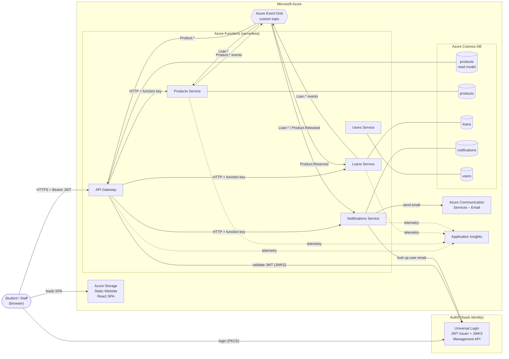
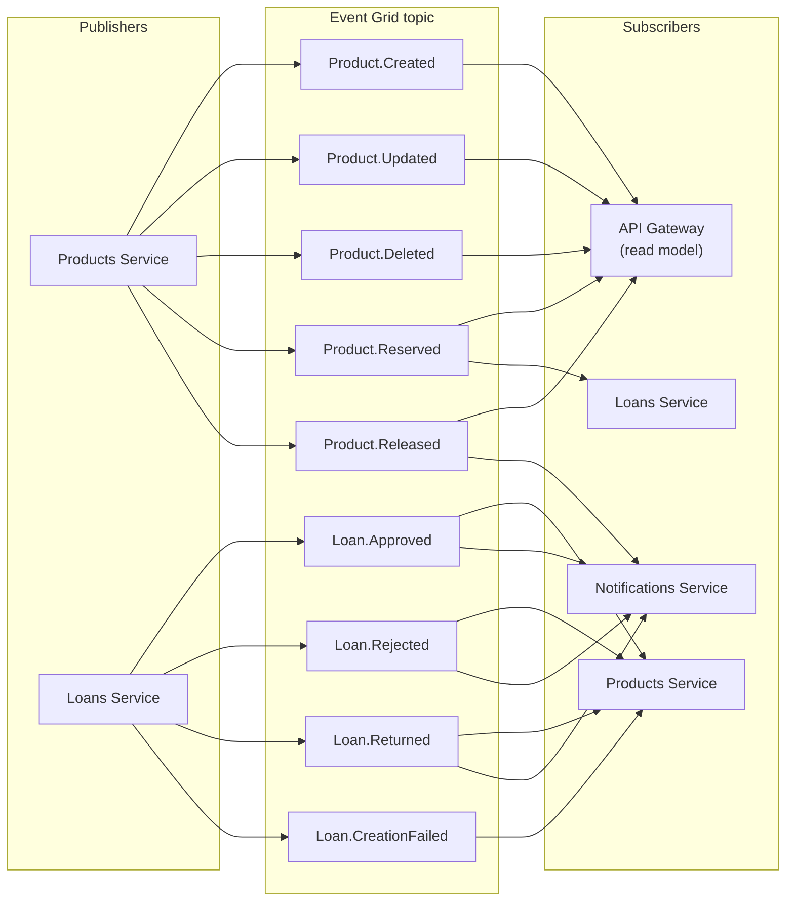
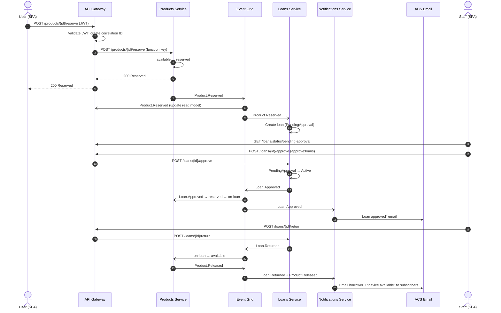
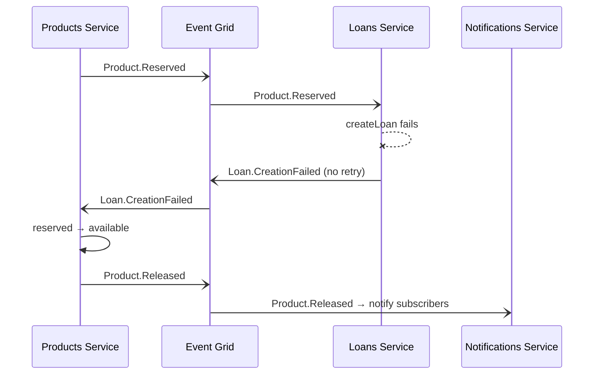
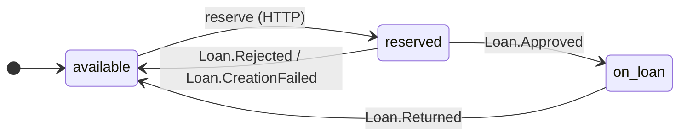
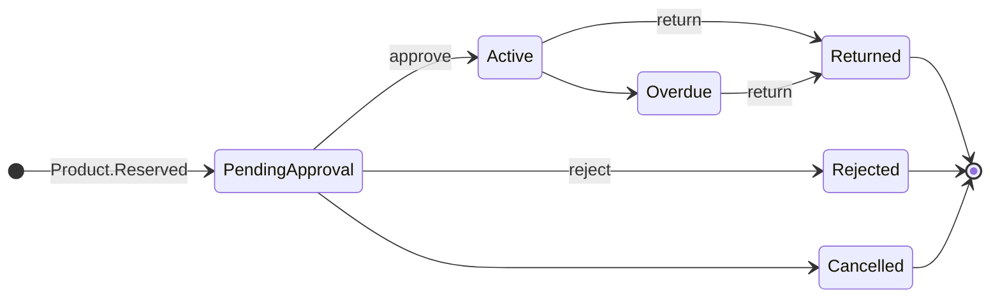
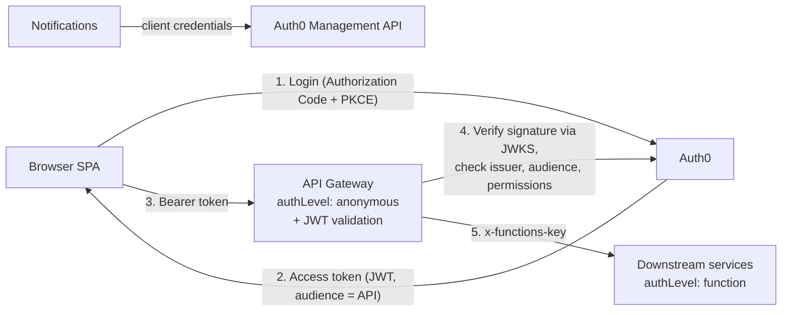

<div align="center">

# 📱 DeviceLoan

**An event-driven microservices system built entirely on Azure serverless.**

Students and staff reserve devices, staff approve the loans, and everyone is kept up to date by email. There are five Azure Function Apps, and they coordinate only through Azure Event Grid.


[Architecture](#-architecture) · [Highlights](#-engineering-highlights) · [Event flows](#-how-it-works) · [Services](#-services) · [Run it](#-running-locally) · [Retrospective](#-retrospective)

</div>

---

## 🎯 About the project

I built DeviceLoan to get hands-on with **serverless, event-driven architecture on Microsoft Azure**. The goal was a real system rather than a hello-world: it has a full request lifecycle, several independently deployable services, asynchronous side effects, failure handling, authentication and observability.

The domain is simple enough to follow quickly and rich enough to need real distributed-systems patterns:

> A user reserves a laptop. A loan request is created **asynchronously**. A member of staff approves it. The device is marked on-loan and the borrower is emailed. When the device comes back, everyone waiting for it is told it's available.

### What it demonstrates

| Area | What I implemented |
|---|---|
| **Serverless compute** | 5 Azure Function Apps (Node.js v4 programming model, TypeScript), with HTTP and Event Grid triggers. Each scales and deploys on its own. |
| **Event-driven architecture** | Choreography through **Azure Event Grid**: 9 domain event types and 4 subscribing services. No service calls another to change its state. |
| **Distributed data** | Database-per-service on **Azure Cosmos DB**, eventual consistency, a **CQRS** read model at the gateway, and a **compensating-action saga** for failures. |
| **SaaS integration** | **Auth0** (OIDC login, RBAC permissions, Management API), **Azure Communication Services** (transactional email) and **Application Insights**. |
| **API design and security** | API gateway / BFF pattern: JWT validation through JWKS, permission checks, and function-key-protected internal services. |
| **Observability** | Correlation IDs carried across HTTP *and* events, W3C `traceparent` support, structured logging and health endpoints. |
| **Software design** | Ports-and-adapters (hexagonal) layering in every service, so business logic is unit-testable without Azure. |
| **Front end** | React 19 SPA (Vite, Tailwind, React Router) with Auth0 login and protected routes, hosted on an Azure Storage static website. |
| **Delivery** | GitHub Actions pipelines per service, with separate `dev` and `prod` Azure environments. |

---

## 🏗 Architecture



### Tech stack

| Layer | Technology |
|---|---|
| Front end | React 19, TypeScript, Vite 7, Tailwind CSS 4, React Router 7, `@auth0/auth0-react` |
| Compute | Azure Functions v4 (Node.js, TypeScript) |
| Messaging | Azure Event Grid (custom topic, Event Grid schema), `@azure/eventgrid` |
| Data | Azure Cosmos DB (NoSQL API), `@azure/cosmos` |
| Email | Azure Communication Services Email, `@azure/communication-email` |
| Identity | Auth0 (OIDC / OAuth 2.0, RBAC permissions, Management API), `jsonwebtoken`, `jwks-rsa`, `jose` |
| Monitoring | Azure Application Insights, `applicationinsights` |
| Hosting | Azure Storage static website (SPA), Azure Function Apps (APIs) |
| Testing | Vitest, Testing Library |
| CI/CD | GitHub Actions, `Azure/functions-action`, Azure CLI |

---

## ✨ Engineering highlights

### 1. Choreography over orchestration
There is no central workflow engine. Each service reacts to the events it cares about and publishes its own. To add a new consumer, such as an analytics service, you create a new Event Grid subscription and leave the existing services alone.

### 2. A compensating-action saga
Reserving a device and creating its loan happen in **different services with different databases**. If the loans service can't create the loan, it publishes `Loan.CreationFailed`, and the products service *undoes* the reservation. The handler deliberately **chooses between retrying and compensating, never both**, so it can't create a duplicate loan *and* release the device.

### 3. A CQRS read model at the edge
The API gateway keeps its own denormalised product catalogue in Cosmos DB, updated from `Product.*` events. Browsing devices, the hottest read path, never touches the products service. That keeps reads fast and keeps working if the products service is down.

### 4. Idempotent, retry-safe event handlers
Handlers rethrow on transient failures so Event Grid's at-least-once delivery retries them. They also check current state before acting, so a redelivered event is harmless (for example, releasing a device that is already `available` does nothing).

### 5. End-to-end correlation across async boundaries
The gateway creates a `CorrelationContext` that travels in HTTP headers *and* inside each event's payload (`_correlationId`), and it understands W3C `traceparent`. One reservation can be followed through the gateway, products, Event Grid, loans and notifications in Application Insights.

### 6. Hexagonal architecture in every service
```
functions/  →  app/ (use cases)  →  domain/ (entities, events, ports)
                                         ↑
                    infra/ (Cosmos, Event Grid, ACS, Auth0 adapters)
```
Azure SDKs live only in `infra/`. Use cases are tested against in-memory fakes, and separate integration tests exercise the real adapters.

### 7. Defence in depth
Only the gateway is public. It validates Auth0 JWTs and enforces permissions such as `approve:loans`, `read:all-loans` and `return:all-loans`. Downstream Function Apps use `authLevel: "function"`, and only the gateway holds their keys, so they never reach the browser.

---

## 🔄 How it works

### Event map



| Event | Publisher | Who reacts and how |
|---|---|---|
| `Product.Created` / `Updated` / `Deleted` | products | **gateway:** updates the read model |
| `Product.Reserved` | products | **loans:** creates a `PendingApproval` loan. **gateway:** marks it reserved |
| `Product.Released` | products | **gateway:** marks it available. **notifications:** emails waiting subscribers |
| `Loan.Approved` | loans | **products:** sets `on-loan`. **notifications:** emails the borrower |
| `Loan.Rejected` | loans | **products:** releases the device. **notifications:** emails the borrower |
| `Loan.Returned` | loans | **products:** releases the device. **notifications:** emails the borrower |
| `Loan.CreationFailed` | loans | **products:** compensating release of the reservation |

### The happy path: reserve, approve, return



<details>
<summary><b>The failure path: compensating a failed loan creation</b></summary>



</details>

<details>
<summary><b>State machines: product and loan</b></summary>





</details>

<details>
<summary><b>Security flow</b></summary>



</details>

---

## 🧩 Services

| Service | Responsibility | Triggers | Publishes | Subscribes to |
|---|---|---|---|---|
| [`apps/web-app`](apps/web-app) | React SPA: browse, reserve, my loans, approvals, notifications | – | – | – |
| [`services/api-gateway`](services/api-gateway) | Public API, JWT and permission checks, routing, product read model | HTTP, Event Grid | – | `Product.*` |
| [`services/products-service`](services/products-service) | Device catalogue and availability | HTTP, Event Grid | `Product.*` | `Loan.*` |
| [`services/loans-service`](services/loans-service) | Loan lifecycle and approvals | HTTP, Event Grid | `Loan.*` | `Product.Reserved` |
| [`services/notifications-service`](services/notifications-service) | Emails, availability subscriptions, history | HTTP, Event Grid | – | `Loan.Approved/Rejected/Returned`, `Product.Released` |
| [`services/users-service`](services/users-service) | User-profile CRUD with Auth0 middleware (standalone, not yet wired to the gateway) | HTTP | – | – |

<details>
<summary><b>Public API (served by the gateway)</b></summary>

| Method | Route | Purpose | Permission |
|---|---|---|---|
| GET    | `/api/products` | List the catalogue (read model) | – |
| POST   | `/api/products/{id}/reserve` | Reserve a device | signed in |
| GET    | `/api/users/{userId}/loans` | A user's loans | own loans, or `read:all-loans` |
| GET    | `/api/loans/status/pending-approval` | Loans awaiting approval | `approve:loans` |
| GET    | `/api/loans/status/active` | Active loans | `return:all-loans` |
| POST   | `/api/loans/{id}/approve` | Approve a loan | `approve:loans` |
| POST   | `/api/loans/{id}/reject` | Reject a loan | `approve:loans` |
| POST   | `/api/loans/{id}/return` | Mark a loan as returned | `return:all-loans` |
| POST   | `/api/notifications/subscribe` | Get notified when a device is available | signed in |
| DELETE | `/api/notifications/unsubscribe/{productId}` | Unsubscribe | signed in |
| GET    | `/api/notifications/preferences` | My subscriptions | signed in |
| GET    | `/api/notifications/history` | My notification history | signed in |
| GET    | `/api/health` | Health check | – |

</details>

### Repository layout

```text
deviceloan/
├── apps/
│   └── web-app/                  # React SPA
└── services/
    ├── api-gateway/              # BFF / gateway + product read model
    ├── products-service/         # catalogue, reservation, Product.* events
    ├── loans-service/            # loan lifecycle, Loan.* events
    ├── notifications-service/    # email + availability subscriptions
    └── users-service/            # user CRUD (standalone)
```

Each service follows the same structure: `functions/` (trigger adapters), `app/` (use cases), `domain/` (entities, events, ports), `infra/` (Azure and SaaS adapters), `config/` (composition root) and `__tests__/`.

---

## 🚀 Running locally

**Prerequisites:** Node.js 20+, [Azure Functions Core Tools v4](https://learn.microsoft.com/azure/azure-functions/functions-run-local), and a Cosmos DB account or the emulator. The full end-to-end flow also needs an Event Grid topic, an Auth0 tenant and an ACS Email resource.

```bash
# Any Function App
cd services/products-service
cp local.settings.example local.settings.json   # fill in your values
npm install
npm start                                        # builds TypeScript, then runs `func start`

# Web app
cd apps/web-app
cp .env.example .env                             # VITE_AUTH0_*, VITE_API_GATEWAY_BASE_URL
npm install
npm run dev
```

<details>
<summary><b>Configuration reference</b></summary>

| Service | Settings |
|---|---|
| api-gateway | `COSMOS_ENDPOINT`, `COSMOS_KEY`, `COSMOS_DATABASE_ID`, `COSMOS_CONTAINER_ID`, `AUTH0_DOMAIN`, `AUTH0_AUDIENCE`, `{PRODUCTS,LOANS,NOTIFICATIONS}_SERVICE_BASE_URL`, `*_SERVICE_HOST_KEY`, `APPLICATIONINSIGHTS_CONNECTION_STRING` |
| products / loans | `COSMOS_ENDPOINT`, `COSMOS_KEY`, `COSMOS_DATABASE_ID`, `COSMOS_CONTAINER_ID`, `EVENTGRID_ENDPOINT`, `EVENTGRID_KEY` |
| notifications | `COSMOS_*`, `COMMUNICATION_CONNECTION_STRING`, `SENDER_EMAIL_ADDRESS`, `AUTH0_DOMAIN`, `AUTH0_CLIENT_ID`, `AUTH0_CLIENT_SECRET` |
| users | `COSMOS_DB_CONNECTION_STRING`, `COSMOS_DB_DATABASE_NAME`, `COSMOS_DB_CONTAINER_NAME`, `AUTH0_DOMAIN`, `AUTH0_AUDIENCE` |

To test Event Grid triggers locally, expose `func start` through a tunnel (ngrok or VS Code dev tunnels) and point an Event Grid subscription at `/runtime/webhooks/EventGrid?functionName=<name>`, or POST a sample event straight to that endpoint.

Useful scripts: `npm run seed` (products: sample devices) and `npm run sync-products` (gateway: backfill the read model).

</details>

### Testing

Every project uses **Vitest**:

```bash
npm test                  # everything
npm run test:unit         # use cases and domain against in-memory fakes
npm run test:integration  # real Cosmos DB / Event Grid adapters
npm run test:coverage
```

---

## ☁️ Deployment

| Component | Azure resource | Pipeline |
|---|---|---|
| Web app | Storage account static website (`$web`) | test → build → `az storage blob upload-batch` |
| API gateway, products, loans, notifications | Function Apps `deviceloan-wc25-{dev,prod}-*` | build → zip → `Azure/functions-action@v1` |

The `dev` branch deploys to the **dev** environment and `main` deploys to **prod**. Each project's original workflow is kept in its own `.github/workflows` folder.

---

## 🔍 Retrospective

### Trade-offs I made
- **Events vs synchronous calls:** choreography made the services loosely coupled and easy to extend. In return, the system is *eventually* consistent: a loan appears shortly *after* the reservation succeeds, rather than in the same transaction.
- **A read model at the gateway:** fast, resilient reads at the cost of duplicated data and a sync job (`sync-products`) for backfills.
- **Function keys for internal calls:** simple and effective for this scale. A larger system would use private networking or managed identity.

### What I'd do next
- [ ] **Infrastructure as code** (Bicep or Terraform) for the Function Apps, Event Grid topic and subscriptions, Cosmos DB and ACS.
- [ ] **Managed identity** in place of Cosmos and Event Grid access keys.
- [ ] **Dead-letter storage** and alerts on Event Grid subscriptions.
- [ ] A **timer-triggered function** that moves loans to `Overdue` and sends reminder emails.
- [ ] Connect **users-service** to the gateway.
- [ ] Consolidate CI into root-level, path-filtered GitHub Actions workflows for this monorepo.
- [ ] Contract tests for event schemas shared between publishers and consumers.

---

## 📂 About this repository

DeviceLoan began as six separate repositories, one per deployable unit. This monorepo combines them **with every original commit preserved** (imported with `git filter-repo --to-subdirectory-filter`), so `git log -- services/<name>` shows the full history of each service. The `main` and `dev` branches mirror the original branches.

---

<div align="center">

Built by **[Will Cornforth](https://github.com/willcornforth)**. Questions or feedback are welcome through GitHub issues.

</div>
