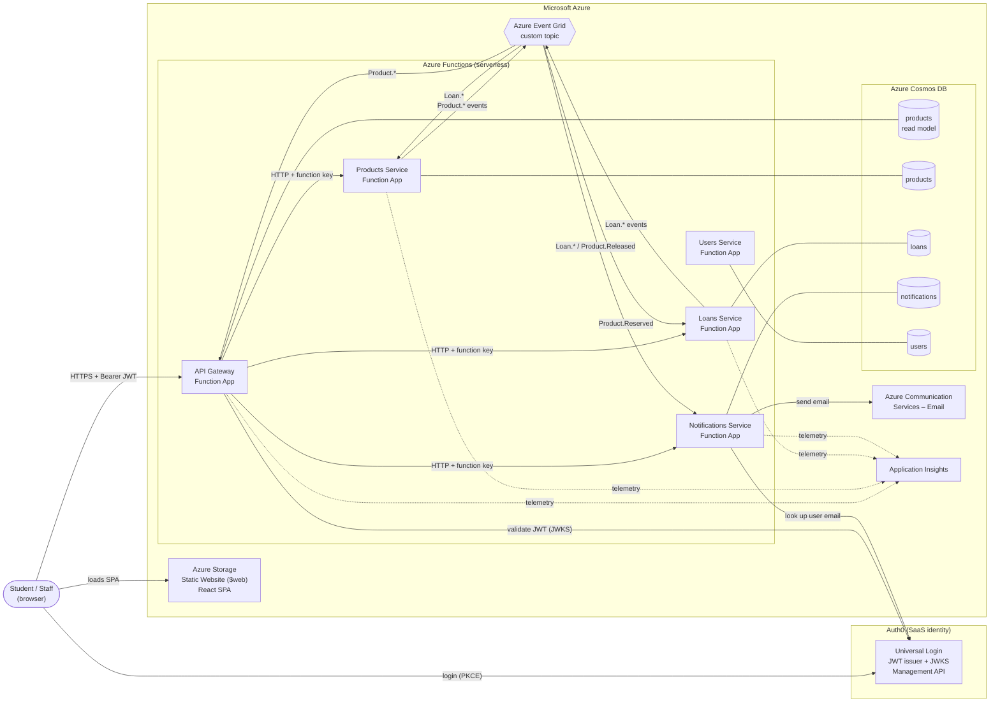
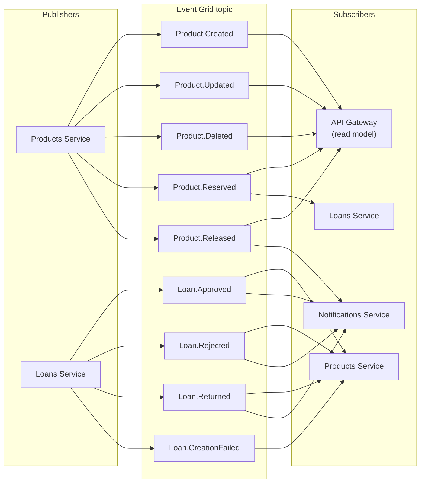
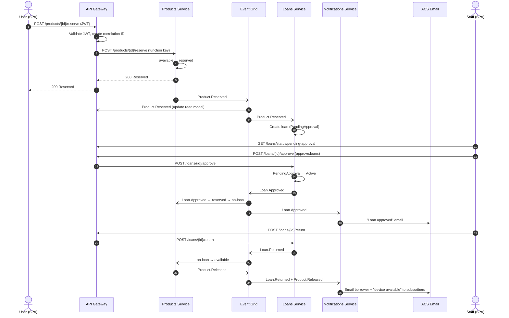
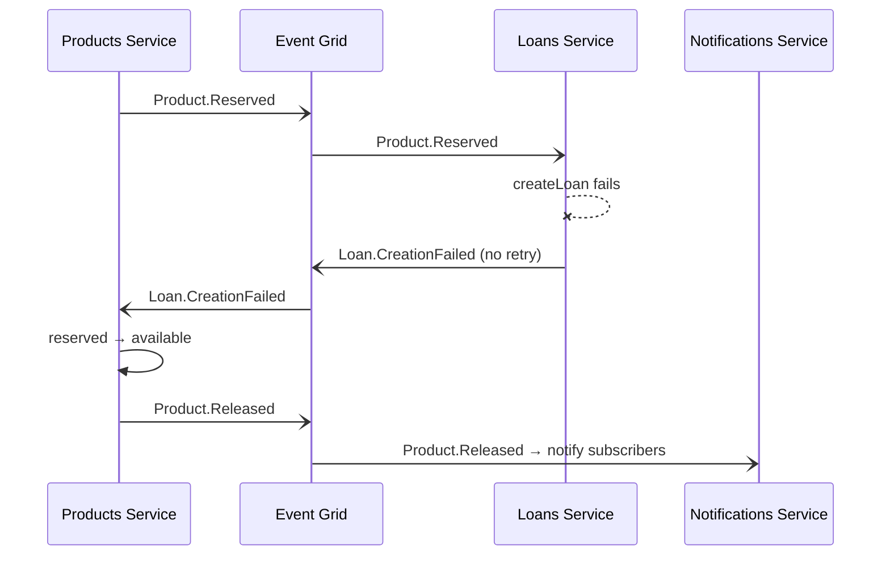
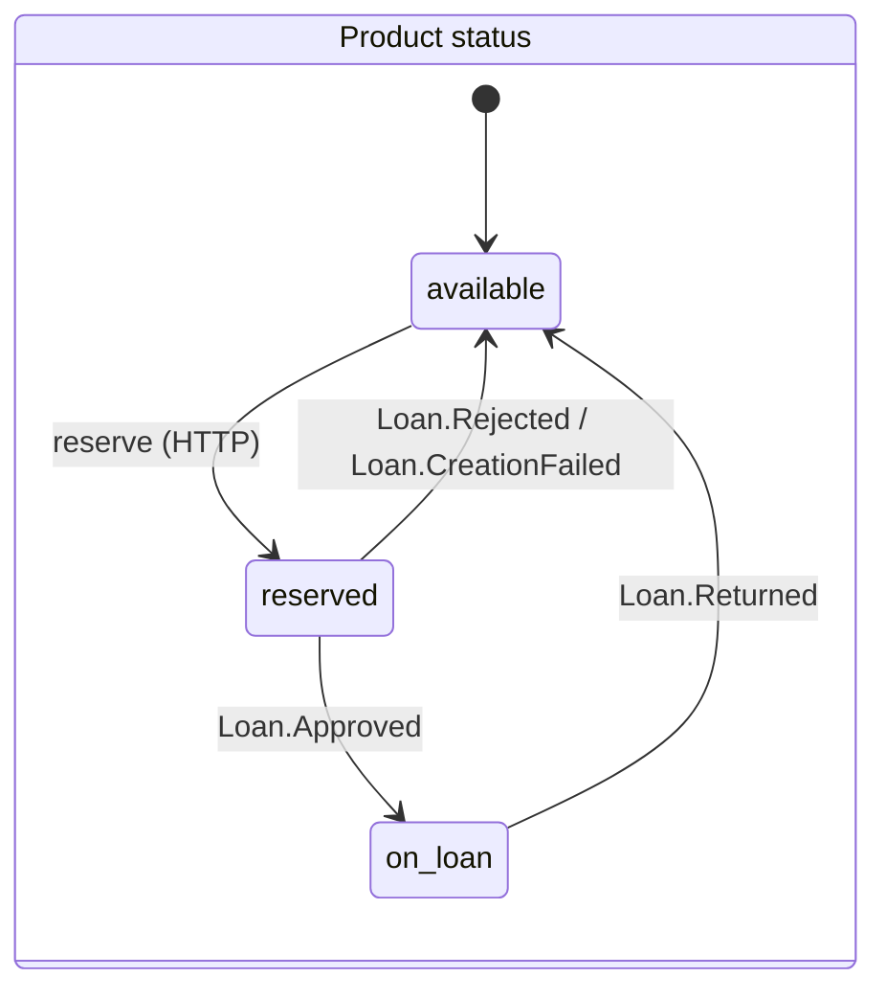
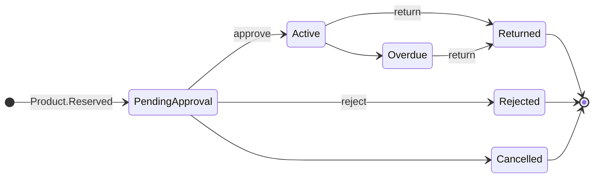
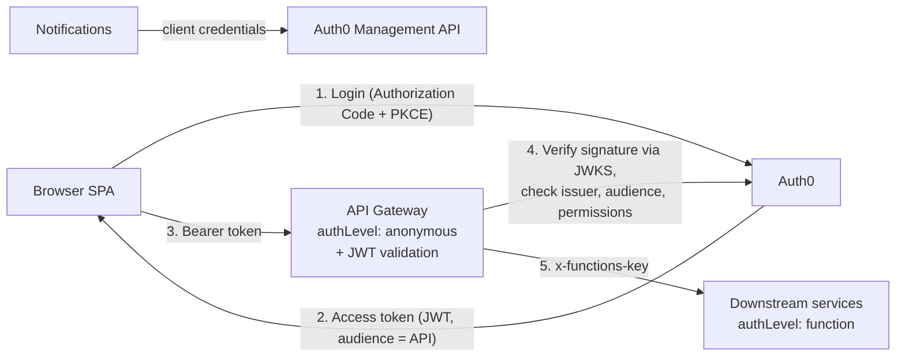

# DeviceLoan: an event-driven serverless system on Azure

DeviceLoan lets students and staff browse a catalogue of devices (laptops, tablets, cameras and so on), reserve one, and track the loan through approval, collection and return. Staff approve or reject requests. Users can also subscribe to a device and get an email when it becomes available again.

I built it to show practical skills with:

- **Azure Functions (serverless, Node.js v4 programming model, TypeScript):** five independently deployable Function Apps.
- **Azure Event Grid:** asynchronous, choreographed communication between services (no service calls another service to change its state).
- **Azure SaaS / PaaS building blocks:** Cosmos DB, Communication Services (Email), Storage static website hosting, Application Insights, and Auth0 as the external identity provider.

This repository is a **monorepo** that combines the six original `deviceloan-*` repositories. Each project's code is unchanged and its full commit history is preserved (see [Repository history](#repository-history)).

---

## Contents

1. [Repository layout](#repository-layout)
2. [System architecture](#system-architecture)
3. [Services](#services)
4. [Event-driven design](#event-driven-design)
5. [Key flows](#key-flows)
6. [Domain state machines](#domain-state-machines)
7. [Security](#security)
8. [Observability](#observability)
9. [Deployment and environments](#deployment-and-environments)
10. [Running locally](#running-locally)
11. [Testing](#testing)
12. [Repository history](#repository-history)

---

## Repository layout

```text
deviceloan/
├── apps/
│   └── web-app/                  # React 19 + Vite + Tailwind SPA (was deviceloan-reactapp)
└── services/
    ├── api-gateway/              # Backend-for-frontend / API gateway Function App
    ├── products-service/         # Device catalogue + reservation (publishes Product.* events)
    ├── loans-service/            # Loan lifecycle (publishes Loan.* events)
    ├── notifications-service/    # Email notifications + availability subscriptions
    └── users-service/            # User management CRUD (standalone)
```

Every service follows the same layered (clean / hexagonal) structure, which keeps Azure SDK code at the edges and the business logic testable:

| Folder      | Responsibility                                                                 |
|-------------|---------------------------------------------------------------------------------|
| `functions/` | Azure Function trigger bindings (HTTP + Event Grid). Thin adapters only.        |
| `app/`       | Use cases (e.g. `reserve-product`, `approveLoan`, `handle-loan-returned`).       |
| `domain/`    | Entities, value types, event contracts and repository/port interfaces.          |
| `infra/`     | Adapters: Cosmos DB repositories, Event Grid publishers, ACS email, Auth0, HTTP. |
| `config/`    | Composition root that wires adapters into use cases from environment settings. |
| `__tests__/` | Vitest unit and integration tests.                                               |

---

## System architecture



### Architectural principles

- **Database per service.** Each service owns its Cosmos DB container. No service reads another service's data directly.
- **Commands go over HTTP, state changes travel as events.** The gateway forwards user *commands* (reserve, approve, return) to the owning service over HTTP. Side effects in other services are triggered only by Event Grid events (choreography, not orchestration).
- **Eventual consistency with compensating actions.** A reservation creates the loan asynchronously. If that fails, a `Loan.CreationFailed` event compensates by releasing the device (a lightweight saga).
- **CQRS read model at the edge.** The API gateway keeps its own denormalised copy of the product catalogue, kept up to date from `Product.*` events. `GET /products` is served without calling the products service.
- **Serverless by default.** No VMs or containers to manage. Each Function App scales independently and costs nothing when idle.

---

## Services

### `apps/web-app`: React SPA

- React 19, React Router 7, Tailwind CSS 4, Vite 7, Vitest + Testing Library.
- Signs users in with `@auth0/auth0-react` and calls **only** the API gateway (`VITE_API_GATEWAY_BASE_URL`).
- Pages: **Home**, **Devices** (browse, search, filter, reserve), **Loans** (my loans), **Approvals** (staff), **Notifications** (subscriptions and history). Loans, Approvals and Notifications are behind `ProtectedRoute`.
- Built and deployed as static files to the `$web` container of an Azure Storage account.

### `services/api-gateway`: API gateway / BFF

The single public entry point for the SPA. It validates Auth0 JWTs, enforces permissions, adds correlation IDs, and forwards to downstream services with their function keys (`x-functions-key`). Downstream keys never reach the browser.

| Method | Route | Purpose | Downstream |
|---|---|---|---|
| GET    | `/api/products` | List the catalogue (local read model) | Cosmos (gateway container) |
| POST   | `/api/products/{id}/reserve` | Reserve a device | products-service |
| GET    | `/api/users/{userId}/loans` | A user's loans | loans-service |
| GET    | `/api/loans/status/pending-approval` | Loans awaiting approval (`read:all-loans`) | loans-service |
| GET    | `/api/loans/status/active` | Active loans (`return:all-loans`) | loans-service |
| POST   | `/api/loans/{id}/approve` | Approve a loan (`approve:loans`) | loans-service |
| POST   | `/api/loans/{id}/reject` | Reject a loan | loans-service |
| POST   | `/api/loans/{id}/return` | Mark a loan as returned | loans-service |
| POST   | `/api/notifications/subscribe` | Subscribe to a device's availability | notifications-service |
| DELETE | `/api/notifications/unsubscribe/{productId}` | Unsubscribe | notifications-service |
| GET    | `/api/notifications/preferences` | My subscriptions | notifications-service |
| GET    | `/api/notifications/history` | My notification history | notifications-service |
| GET    | `/api/health` | Health check | – |
| Event Grid | `productEventsHandler` | Syncs the product read model from `Product.*` events | – |

`scripts/sync-products.js` backfills the read model from the products service's container.

### `services/products-service`: device catalogue

The source of truth for devices and their availability (`available → reserved → on-loan`).

- HTTP (function-key protected): `POST /products`, `PUT|PATCH /products/{id}`, `DELETE /products/{id}`, `POST /products/{id}/reserve`, `GET /health`.
- **Publishes:** `Product.Created`, `Product.Updated`, `Product.Deleted`, `Product.Reserved`, `Product.Released`.
- **Subscribes:** `Loan.Approved` (mark on-loan), `Loan.Rejected` / `Loan.Returned` / `Loan.CreationFailed` (release the device and publish `Product.Released`).
- `npm run seed` loads sample devices into Cosmos DB.

### `services/loans-service`: loan lifecycle

The source of truth for loans.

- HTTP (function-key protected): create, get, update, delete loans; list by user, by product, pending approval and active; approve, reject, return; `GET /health`.
- **Subscribes:** `Product.Reserved`, which creates a `PendingApproval` loan (due date from the reservation, or two days by default).
- **Publishes:** `Loan.Approved`, `Loan.Rejected`, `Loan.Returned`, `Loan.CreationFailed`.

### `services/notifications-service`: email notifications

- **Subscribes:** `Loan.Approved`, `Loan.Rejected`, `Loan.Returned`, `Product.Released`.
- Resolves the recipient's email address through the **Auth0 Management API** (client-credentials flow), sends mail through **Azure Communication Services Email**, and stores a notification history record in Cosmos DB.
- Manages per-user "notify me when available" subscriptions. When `Product.Released` fires, every subscriber to that device gets an email.
- HTTP (function-key protected): subscribe, unsubscribe, list preferences, history, `GET /health`.

### `services/users-service`: user management

A standalone CRUD service for user profiles (`GET/POST /users`, `GET/PUT/DELETE /users/{id}`), protected by Auth0 JWT middleware and backed by Cosmos DB. It follows a classic layered DDD structure (`api` / `application` / `domain` / `infrastructure`) and has its own README, CONTRIBUTING, TESTING and PROJECT_SUMMARY docs. **The gateway does not call it yet.** User identity is currently sourced from Auth0 directly.

---

## Event-driven design

All domain events use the **Event Grid event schema** and go to an Event Grid custom topic (`EVENTGRID_ENDPOINT` / `EVENTGRID_KEY`). Each consumer is an `app.eventGrid(...)` Function with an Event Grid subscription filtered by event type.



| Event | Publisher | Consumers and reaction |
|---|---|---|
| `Product.Created` / `Updated` / `Deleted` | products | **gateway:** upsert or delete in the read model |
| `Product.Reserved` | products | **loans:** create a `PendingApproval` loan. **gateway:** mark reserved |
| `Product.Released` | products | **gateway:** mark available. **notifications:** email subscribers |
| `Loan.Approved` | loans | **products:** set `on-loan`. **notifications:** email borrower |
| `Loan.Rejected` | loans | **products:** release device. **notifications:** email borrower |
| `Loan.Returned` | loans | **products:** release device. **notifications:** email borrower |
| `Loan.CreationFailed` | loans | **products:** compensating release of the reservation |

**Reliability.** Handlers rethrow on transient failure so Event Grid's built-in retry policy redelivers. Handlers are written to be idempotent (for example, releasing a device that is already `available` is a no-op). The loans service publishes `Loan.CreationFailed` *instead* of retrying once it knows the reservation must be undone, so it never retries and compensates at the same time.

---

## Key flows

### Reserve, approve and return a device



### Compensation when loan creation fails



---

## Domain state machines





---

## Security



- **User authentication:** Auth0 Universal Login, with refresh tokens in the SPA.
- **Authorisation:** the gateway validates RS256 JWTs (`jsonwebtoken` + `jwks-rsa`) and checks Auth0 RBAC permissions such as `approve:loans`, `read:all-loans` and `return:all-loans`.
- **Service-to-service:** downstream Function Apps use `authLevel: "function"`. Only the gateway holds their host keys (`*_SERVICE_HOST_KEY`).
- **Secrets:** read from Function App settings / GitHub Actions secrets. Only `*.example` settings files are committed.

---

## Observability

- **Application Insights** (`applicationinsights` SDK in the gateway, plus the Functions host integration for every app) collects requests, dependencies, traces and exceptions.
- **Distributed tracing:** a `CorrelationContext` is created at the gateway, propagated over HTTP and copied into Event Grid event data (`_correlationId`). It also understands W3C `traceparent`. Every log line carries the same correlation prefix, so one reservation can be traced across all services.
- Every service exposes an anonymous `GET /api/health` endpoint.

> Correlation tracing and health checks are on the `dev` branch (Jan 2026 work). `main` holds the last production release.

---

## Deployment and environments

| Component | Azure resource (dev / prod) | Pipeline (original) |
|---|---|---|
| Web app | Storage account static website `$web` | `apps/web-app/.github/workflows/deploy-to-azure.yml` (test → build → `az storage blob upload-batch`) |
| API gateway | `deviceloan-wc25-{dev,prod}-api` | `services/api-gateway/.github/workflows/*` |
| Products | `deviceloan-wc25-{dev,prod}-products-service` | `services/products-service/.github/workflows/*` |
| Loans | `deviceloan-wc25-{dev,prod}-loans-service` | `services/loans-service/.github/workflows/*` |
| Notifications | `deviceloan-wc25-{dev,prod}-notifications-service` | `services/notifications-service/.github/workflows/*` |
| Users | – (no pipeline) | – |

Each Function App pipeline builds with Node.js, zips the artefact and deploys with `Azure/functions-action@v1` after `azure/login@v2`. The `dev` branch deploys to `*-dev-*` apps and `main` deploys to `*-prod-*` apps.

> **Note:** the workflow files were moved here unchanged inside each project folder. GitHub Actions only runs workflows from the repository root `.github/workflows/`, so **these pipelines don't run from this monorepo**. To turn CI/CD back on, copy them to the root and add `paths:` filters and `working-directory:` / `package:` settings for each service.

---

## Running locally

Prerequisites: Node.js 20+ (the web pipeline uses 22), [Azure Functions Core Tools v4](https://learn.microsoft.com/azure/azure-functions/functions-run-local), and a Cosmos DB account or the emulator. Event Grid, Auth0 and ACS credentials are needed for the full end-to-end flow.

```bash
# Any Function App
cd services/products-service
cp local.settings.example local.settings.json   # fill in values (name varies slightly per service)
npm install
npm start            # builds the TypeScript, then runs `func start`

# Web app
cd apps/web-app
cp .env.example .env # VITE_AUTH0_*, VITE_API_GATEWAY_BASE_URL
npm install
npm run dev
```

Main settings per service:

| Service | Settings |
|---|---|
| api-gateway | `COSMOS_ENDPOINT`, `COSMOS_KEY`, `COSMOS_DATABASE_ID`, `COSMOS_CONTAINER_ID`, `AUTH0_DOMAIN`, `AUTH0_AUDIENCE`, `{PRODUCTS,LOANS,NOTIFICATIONS}_SERVICE_BASE_URL`, `*_SERVICE_HOST_KEY`, `APPLICATIONINSIGHTS_CONNECTION_STRING` |
| products / loans | `COSMOS_ENDPOINT`, `COSMOS_KEY`, `COSMOS_DATABASE_ID`, `COSMOS_CONTAINER_ID`, `EVENTGRID_ENDPOINT`, `EVENTGRID_KEY` |
| notifications | `COSMOS_*`, `COMMUNICATION_CONNECTION_STRING`, `SENDER_EMAIL_ADDRESS`, `AUTH0_DOMAIN`, `AUTH0_CLIENT_ID`, `AUTH0_CLIENT_SECRET` |
| users | `COSMOS_DB_CONNECTION_STRING`, `COSMOS_DB_DATABASE_NAME`, `COSMOS_DB_CONTAINER_NAME`, `AUTH0_DOMAIN`, `AUTH0_AUDIENCE` |

To test Event Grid triggers locally, expose `func start` through a tunnel (for example ngrok or VS Code dev tunnels) and point an Event Grid subscription at `/runtime/webhooks/EventGrid?functionName=<name>`, or POST a sample event to that endpoint directly.

---

## Testing

Every project uses **Vitest**:

```bash
npm test                  # all tests
npm run test:unit         # unit tests (use cases, domain, adapters with fakes)
npm run test:integration  # integration tests against Cosmos DB / Event Grid
npm run test:coverage
```

The ports-and-adapters design means use cases are tested against in-memory fakes of the repository, publisher and email ports. Integration tests exercise the real Cosmos DB and Event Grid adapters. The web app uses Testing Library component tests.

---

## Repository history

This monorepo was assembled with `git filter-repo --to-subdirectory-filter` followed by unrelated-history merges, so **every original commit is kept** with its author and date, just moved into the new folder. `git log -- services/loans-service` shows the full history of the former repository.

| Original repository | Location | Branches imported |
|---|---|---|
| `deviceloan-reactapp` | `apps/web-app` | `main`, `dev` |
| `deviceloan-api-gateway` | `services/api-gateway` | `main`, `dev` |
| `deviceloan-products-service` | `services/products-service` | `main`, `dev` |
| `deviceloan-loans-service` | `services/loans-service` | `main`, `dev` |
| `deviceloan-notifications-service` | `services/notifications-service` | `main`, `dev` |
| `deviceloan-users-service` | `services/users-service` | `main`, `dev` |

The monorepo's `main` branch contains each repository's `main`, and its `dev` branch contains each repository's `dev`. Each project's file tree is byte-for-byte identical to its source branch.
